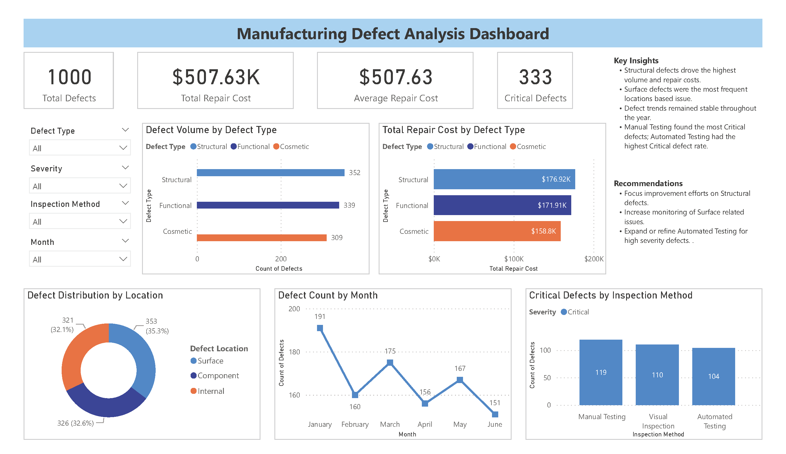

# Manufacturing Defect Analysis

## Project Overview

This project analyzes manufacturing defect data to identify quality trends, repair cost drivers, defect locations, and inspection effectiveness. The analysis was performed using Excel, MySQL, and Power BI.

## Dashboard Preview


## Business Problem

A manufacturing organization wants to better understand product quality issues by answering the following questions:

1. Which defect types occur most frequently?
2. Which defect types generate the highest repair costs?
3. Where do defects occur most often?
4. How do defect trends change over time?
5. Which inspection methods identify the most critical defects?

## Tools Used

- Excel
- MySQL
- Power BI

## Dataset

The dataset contains 1,000 manufacturing defect records.

### Fields Included

- Defect ID
- Product ID
- Defect Type
- Defect Date
- Defect Location
- Severity
- Inspection Method
- Repair Cost

## Data Preparation

### Excel Data Cleaning

The dataset was reviewed for:

- Missing values
- Duplicate records
- Formatting inconsistencies
- Data quality issues

### Cleaning Results

- No missing values identified
- Duplicate records were acceptable within the dataset context
- No formatting inconsistencies were found
- Added Month and Year columns for trend analysis
- Saved a cleaned version of the dataset

### Data Import & Validation

1. Exported the cleaned Excel file to CSV.
2. Imported data into MySQL using MySQL Workbench.
3. Validated:
   - Record counts
   - Date ranges
   - Data completeness
   - Data integrity

## Project Workflow

```text
Excel
   │
   ▼
Data Cleaning
   │
   ▼
MySQL
   │
   ├─ Data Validation
   ├─ SQL Analysis
   │
   ▼
Power BI
   │
   └─ Dashboard & Insights
```

## Key Findings

### Defect Volume by Type

| Defect Type | Defect Count |
|------------|-------------:|
| Structural | 352 |
| Functional | 339 |
| Cosmetic | 309 |

**Insight:** Structural defects account for the highest defect volume.

### Repair Cost by Defect Type

| Defect Type | Total Repair Cost |
|------------|------------------:|
| Structural | $176,923.85 |
| Functional | $171,905.58 |
| Cosmetic | $158,797.72 |

**Total Repair Cost:** $507,627.15

**Insight:** Structural defects generated the highest repair costs.

### Defect Distribution by Location

| Defect Location | Defect Count |
|----------------|-------------:|
| Surface | 353 |
| Component | 326 |
| Internal | 321 |

**Insight:** Surface defects occur most frequently.

### Defect Trends Over Time

Defect counts fluctuated during the reporting period without indicating a clear seasonal trend. Additional historical data would be required to identify long-term patterns.

### Critical Defects by Inspection Method

| Inspection Method | Critical | Minor | Moderate | Total |
|------------------|---------:|------:|---------:|------:|
| Automated Testing | 104 | 101 | 92 | 297 |
| Manual Testing | 119 | 135 | 98 | 352 |
| Visual Inspection | 110 | 122 | 119 | 351 |

**Insight:** Manual Testing identified the most critical defects.

## Key Insights

- Structural defects drove the highest defect volume and repair costs.
- Surface defects were the most common location-based issue.
- Repair costs generally aligned with defect volume.
- Defect activity remained stable during the reporting period.
- Manual Testing found the most Critical defects.

## Recommendations

- Prioritize root-cause analysis of Structural defects.
- Increase quality controls for Surface-related issues.
- Continue monitoring long-term defect trends.
- Evaluate testing strategies to improve Critical defect detection.

## Skills Demonstrated

### Data Analysis

- Data Validation
- Exploratory Data Analysis (EDA)
- Trend Analysis

### SQL

- Aggregations
- GROUP BY Analysis
- Data Validation Queries

### Power BI

- KPI Cards
- Interactive Slicers
- Dashboard Design
- Data Visualization

### Business Analysis

- Insight Generation
- Data Storytelling
- Recommendation Development
